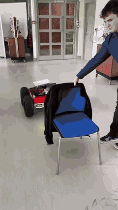

# ROS Robot Navigation in MATLAB

Spatial Robotics coursework: autonomous waypoint navigation, trajectory following and LiDAR-based obstacle avoidance for a differential-drive mobile robot, written in MATLAB with ROS Toolbox. The final task ports the strategies to a real **Panther** robot running **ROS 2**.

## What's in it

| Script | Task |
|---|---|
| `AssB1Task1.m` | Drive to a single target or a list of waypoints with a proportional controller (separate gains for heading and distance, speed limits, stop thresholds). |
| `AssB1Task2.m` | Follow a continuous predefined trajectory (`trajectory.mat`). |
| `AssB1Task3.m` | Stop when LiDAR detects an obstacle inside a safety distance. |
| `AssB1Task4.m` | Reactive obstacle avoidance: steer around obstacles using the `/scan` LaserScan data, then resume the planned path. |
| `AssB1Task5.m` | The reactive strategies adapted to the Panther robot with ROS 2 (`/cmd_vel`, `/odom`, `/scan`). |

The `.mat` files are the waypoint and trajectory sets the scripts load.

## Demos

Real-robot trial of Task 5 on the Panther robot (the full-quality video is in [`demos/`](demos/)):

  

## How the controller works

1. Read the robot pose from `/odom` and correct it for the known start position.
2. Compute the distance and heading error to the current target.
3. Rotate in place until the heading error is small, then drive forward with a speed proportional to the remaining distance, clamped to a maximum.
4. Stop when within the distance threshold, then move to the next waypoint.

For obstacle avoidance, the LiDAR ranges are checked against a safety distance (0.5 m in Task 4) and the robot steers away before resuming its route.

## Running it

Requires MATLAB with ROS Toolbox.

- Tasks 1-4 use the ROS 1 simulator, started with `ExampleHelperSimulinkRobotROS('ObstacleAvoidance')`.
- Task 5 expects a ROS 2 robot or simulation publishing `/odom` and `/scan`.

The simulator helper files supplied with the course (MathWorks `ExampleHelper*` functions and GUIs) are not included in this repository.
